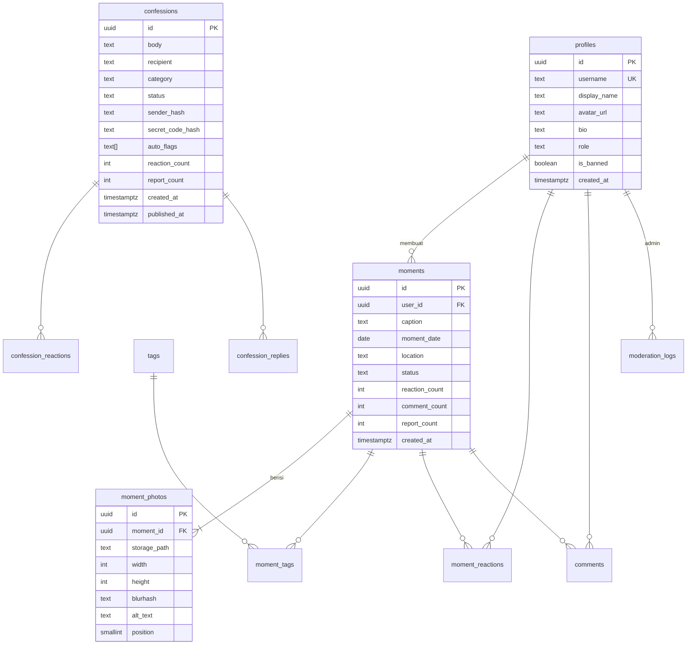

# Database — Moment Pakde

Database: PostgreSQL (Supabase). Semua tabel memakai `uuid` sebagai primary key dan `timestamptz` untuk waktu.

## 1. ERD



## 2. Tabel

### `profiles`
Dibuat otomatis lewat trigger saat user baru mendaftar di `auth.users`.

| Kolom | Tipe | Catatan |
|---|---|---|
| id | uuid PK | = `auth.users.id` |
| username | citext unique | 3–20 karakter, `[a-z0-9_.]` |
| display_name | text | maks. 50 |
| avatar_url | text | |
| bio | text | maks. 160 |
| role | text | `user` \| `moderator` \| `admin`, default `user` |
| is_banned | boolean | default false |
| created_at | timestamptz | default now() |

### `moments`
| Kolom | Tipe | Catatan |
|---|---|---|
| id | uuid PK | |
| user_id | uuid FK → profiles | on delete cascade |
| caption | text | maks. 2200 |
| moment_date | date | default current_date |
| location | text null | maks. 100 |
| status | text | `published` \| `hidden` \| `removed` |
| reaction_count | int | default 0, diperbarui trigger |
| comment_count | int | default 0, diperbarui trigger |
| report_count | int | default 0 |
| created_at, updated_at | timestamptz | |

### `moment_photos`
| Kolom | Tipe | Catatan |
|---|---|---|
| id | uuid PK | |
| moment_id | uuid FK → moments | on delete cascade |
| storage_path | text | `moments/{user_id}/{uuid}.webp` |
| width, height | int | |
| blurhash | text | placeholder |
| alt_text | text | |
| position | smallint | 0–4, unique per moment |

### `tags` & `moment_tags`
| Tabel | Kolom |
|---|---|
| tags | `id` uuid PK, `slug` citext unique, `created_at` |
| moment_tags | `moment_id` FK, `tag_id` FK, PK gabungan |

### `moment_reactions`
| Kolom | Tipe | Catatan |
|---|---|---|
| moment_id | uuid FK | |
| user_id | uuid FK | |
| emoji | text | `love` \| `haha` \| `sad` \| `fire` \| `pray` |
| created_at | timestamptz | |
| | | PK (`moment_id`, `user_id`): satu reaksi per user |

### `comments`
| Kolom | Tipe | Catatan |
|---|---|---|
| id | uuid PK | |
| moment_id | uuid FK | on delete cascade |
| user_id | uuid FK | |
| body | text | 1–500 |
| status | text | `published` \| `hidden` \| `removed` |
| report_count | int | |
| created_at | timestamptz | |

### `confessions`
> ⚠️ **Tidak ada kolom `user_id`.** Ini disengaja untuk menjaga anonimitas.

| Kolom | Tipe | Catatan |
|---|---|---|
| id | uuid PK | |
| short_id | text unique | 8 karakter untuk URL (`/c/ab12cd34`) |
| body | text | 10–1000 |
| recipient | text null | maks. 60 |
| category | text | `naksir` \| `terima_kasih` \| `curhat` \| `minta_maaf` \| `unek_unek` \| `lainnya` |
| status | text | `pending` \| `published` \| `hidden` \| `removed`. Default saat insert ditentukan filter: `published`, atau `pending` jika ada flag berat |
| removal_reason | text null | alasan disembunyikan/dihapus |
| sender_hash | text | HMAC perangkat, hanya untuk rate limit & blokir |
| secret_code_hash | text null | untuk hapus oleh penulis / cek status |
| auto_flags | text[] | flag ringan: `{profanity, mention}`; flag berat (menahan): `{url, spam, selfharm}` |
| reviewed_at | timestamptz null | diisi saat admin menandai "sudah dicek"; tab Perlu Dicek = `auto_flags <> '{}' or report_count > 0` dan `reviewed_at is null` |
| reaction_count, report_count | int | |
| created_at | timestamptz | |
| published_at | timestamptz null | = `created_at` jika langsung tampil |

### `confession_reactions`
| Kolom | Tipe | Catatan |
|---|---|---|
| confession_id | uuid FK | |
| device_hash | text | |
| emoji | text | |
| | | PK (`confession_id`, `device_hash`) |

### `confession_replies` (P1)
| Kolom | Tipe |
|---|---|
| id, confession_id, body (1–500), status, auto_flags, reviewed_at, sender_hash, report_count, created_at | |

### `reports`
| Kolom | Tipe | Catatan |
|---|---|---|
| id | uuid PK | |
| target_type | text | `moment` \| `comment` \| `confession` \| `reply` |
| target_id | uuid | |
| reason | text | `spam` \| `bullying` \| `doxxing` \| `company` (menjelekkan perusahaan/mentor) \| `sexual` \| `other` |
| note | text null | maks. 300 |
| reporter_key | text | user_id atau device_hash |
| status | text | `open` \| `resolved` \| `dismissed` |
| created_at | timestamptz | |
| | | unique (`target_type`, `target_id`, `reporter_key`) |

### `blocked_senders`
| Kolom | Tipe |
|---|---|
| sender_hash PK, reason, blocked_by (FK profiles), expires_at null, created_at | |

### `moderation_logs`
| Kolom | Tipe |
|---|---|
| id, admin_id, action (`review`/`publish`/`hide`/`restore`/`remove`/`ban`/`block`), target_type, target_id, note, created_at | |

### `app_settings`
| key | value (jsonb) | Keterangan |
|---|---|---|
| `confess_autohide_threshold` | `3` | Jumlah laporan sebelum auto-hide |
| `wordlist_profanity` | `["…"]` | Kata kasar (flag ringan) |
| `wordlist_spam` | `["slot","gacor", …]` | Kata kunci spam (menahan) |
| `wordlist_selfharm` | `["…"]` | Frasa menyakiti diri (menahan) |
| `confess_paused` | `false` | Saklar darurat: hentikan sementara confess baru |

## 3. Index

```sql
create index on moments (status, created_at desc, id desc);
create index on moments (user_id, created_at desc);
create index on moments (moment_date);
create index on confessions (status, published_at desc, id desc);
create index on confessions (status, created_at) where status = 'pending';
create index on confessions (report_count desc, created_at desc)
  where reviewed_at is null and status in ('published', 'hidden');
create index on comments (moment_id, created_at);
create index on reports (status, created_at) where status = 'open';
-- Pencarian (P1)
create index on moments using gin (to_tsvector('simple', caption));
create index on confessions using gin (to_tsvector('simple', body));
```

## 4. Trigger

| Trigger | Fungsi |
|---|---|
| `on_auth_user_created` | Buat baris `profiles` dengan username sementara dari email |
| `moment_reactions_count` | Tambah/kurangi `moments.reaction_count` |
| `comments_count` | Tambah/kurangi `moments.comment_count` |
| `reports_autohide` | Naikkan `report_count` target; jika ≥ `confess_autohide_threshold` (default 3) → `status = 'hidden'`, `reviewed_at = null` |
| `set_updated_at` | Perbarui `updated_at` |

## 5. Row Level Security

| Tabel | SELECT | INSERT | UPDATE | DELETE |
|---|---|---|---|---|
| profiles | semua | trigger saja | pemilik (kecuali `role`, `is_banned`) | pemilik |
| moments | `status='published'` atau pemilik atau admin | user login & tidak banned, `user_id = auth.uid()` | pemilik (caption, tags, lokasi) | pemilik atau admin |
| moment_photos | ikut moment | pemilik moment | ✗ | pemilik moment |
| moment_reactions | semua | `user_id = auth.uid()` | pemilik | pemilik |
| comments | `status='published'` atau pemilik | user login & tidak banned | ✗ | pemilik, pemilik moment, admin |
| confessions | `status='published'` (kolom `sender_hash`, `secret_code_hash` **tidak** diekspos; pakai view `public_confessions`) | ✗ (lewat server/service role) | ✗ | ✗ |
| confession_reactions | ✗ (hitungan dari kolom count) | lewat server | lewat server | lewat server |
| reports | admin | lewat server | admin | ✗ |
| blocked_senders, moderation_logs, app_settings | admin | admin | admin | admin |

Contoh view publik:

```sql
create view public_confessions as
select id, short_id, body, recipient, category, reaction_count, published_at
from confessions
where status = 'published';
```

## 6. Storage

| Bucket | Akses baca | Akses tulis | Batas |
|---|---|---|---|
| `moments` | publik | signed URL, path harus diawali `moments/{auth.uid()}/` | 10 MB, `image/webp`, `image/jpeg`, `image/png` |
| `avatars` | publik | pemilik | 2 MB |

## 7. Retensi Data

| Data | Retensi |
|---|---|
| Confess `removed` | dihapus permanen setelah 30 hari |
| `sender_hash` di confess | di-null-kan setelah 90 hari |
| Foto yatim (tidak terhubung moment) | dihapus setelah 24 jam |
| Akun dihapus | semua moment, foto, komentar, reaksi ikut terhapus (cascade) |
