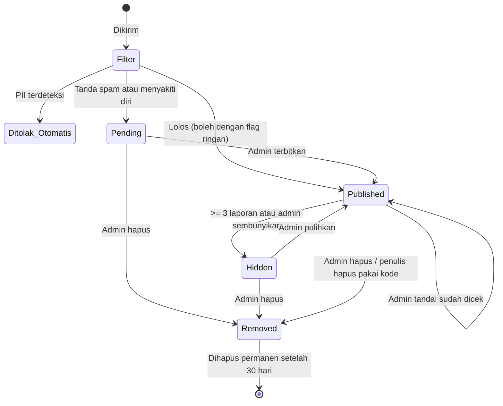

# Moderasi & Privasi — Moment Pakde

Moment Pakde adalah ruang seru-seruan komunitas MagangHub. Karena confess anonim **langsung tampil** tanpa ditinjau dulu, filter otomatis, laporan pengguna, dan respons admin yang cepat adalah satu-satunya pengaman. Dokumen ini menjadi acuan untuk admin dan developer.

## 1. Aturan Komunitas (tampil di `/aturan`)

**Boleh:**
- Berbagi momen magang, cerita, dan perasaan.
- Confess naksir, terima kasih ke mentor/teman, minta maaf, atau curhat soal magang.
- Kritik yang sopan dan tidak menyebut nama.

**Tidak boleh:**
1. Menyebut **nama lengkap**, nomor HP, alamat, akun medsos, atau foto orang lain dengan maksud mempermalukan.
2. Menjelekkan mentor, atasan, atau **perusahaan tempat magang dengan nama jelas**.
3. Membagikan dokumen, layar kerja, atau informasi internal kantor (termasuk di latar foto).
4. Bullying, ancaman, ujaran kebencian (SARA).
5. Konten seksual atau melibatkan anak di bawah umur.
6. Fitnah atau tuduhan kriminal terhadap orang yang bisa dikenali.
7. Spam, promosi, judi online, penipuan, atau lowongan magang palsu.
8. Mengunggah foto orang lain yang jelas tidak ingin difoto/diunggah.

## 2. Alur Moderasi Confess

- `Ditolak_Otomatis` tidak menyimpan apa pun ke database; user langsung diberi tahu di form.
- Confess dengan **flag ringan** (kata kasar, `@username`) tetap tampil, tapi masuk tab **Perlu Dicek** di admin.

## 3. Filter Otomatis

| Filter | Aksi | Implementasi |
|---|---|---|
| Nomor HP Indonesia | **Tolak** di form | Regex `(\+62\|62\|0)8[1-9][0-9]{6,11}` (setelah buang spasi/titik/strip) |
| Email | **Tolak** | Regex email standar |
| NIK (16 digit) | **Tolak** | `\b\d{16}\b` |
| URL | **Tahan** (`pending`) | Deteksi `http`, `www`, `.com`, `bit.ly`, dll. |
| Judi/promosi/loker palsu | **Tahan** | Kata kunci: slot, gacor, maxwin, deposit, "gaji 5 juta tanpa pengalaman", dll. |
| Indikasi menyakiti diri | **Tahan** | Daftar frasa di `lib/moderation/selfharm.ts`; admin menindaklanjuti sesuai §6 |
| Username medsos (`@xxx`) | **Tampil + flag** | `@[a-zA-Z0-9_.]{3,}` |
| Kata kasar/SARA | **Tampil + flag** | Daftar kata di `lib/moderation/wordlist.ts`, termasuk variasi (`4nj1ng`, spasi di antara huruf) |

Semua daftar kata bisa diperbarui admin tanpa deploy (disimpan di `app_settings`).

## 4. Panduan Keputusan Admin

| Situasi | Keputusan |
|---|---|
| Naksir tanpa identitas jelas ("intern yang duduk dekat pantry") | ✅ Biarkan |
| Naksir dengan nama panggilan + divisi ("Dina anak marketing batch 3") | ⚠️ Biarkan jika positif; sembunyikan jika mempermalukan |
| Terima kasih ke mentor dengan nama | ✅ Biarkan (positif) |
| Keluhan soal magang secara umum ("tugasnya fotokopi terus 😭") | ✅ Biarkan |
| Menyebut nama mentor/perusahaan + tuduhan atau hinaan | ❌ Hapus |
| Menyebut nama lengkap + hal negatif | ❌ Hapus (doxxing/fitnah) |
| Curhat yang menyinggung bunuh diri/menyakiti diri | ❌ Jangan terbitkan. Ikuti §6 |
| Spam/promosi/loker mencurigakan | ❌ Hapus + blokir pengirim |
| Pengirim yang sama kontennya dihapus 3x dalam seminggu | Blokir 7 hari |

Alasan standar: `Menyebut identitas orang`, `Menyebut perusahaan secara negatif`, `Kasar/bullying`, `Spam`, `Konten seksual`, `Tidak sesuai aturan`.

**Target respons admin:** konten yang auto-hide karena laporan ditinjau ≤ 6 jam; tab Perlu Dicek dibersihkan minimal 2x sehari.

## 5. Moment & Komentar

- Langsung tampil, disembunyikan otomatis jika ≥ 3 laporan.
- Form upload menampilkan pengingat: "Pastikan tidak ada dokumen kantor atau layar kerja di foto."
- Pemilik moment bisa menghapus komentar di moment-nya.
- User yang di-ban: tidak bisa posting/komentar; konten lamanya disembunyikan.
- Permintaan hapus foto dari orang yang ada di foto: tangani ≤ 48 jam lewat kontak di `/aturan`.

## 6. Kondisi Darurat

Jika confess mengandung indikasi menyakiti diri sendiri:
- Jangan terbitkan.
- Di halaman cek status (P1), tampilkan pesan peduli dan kontak layanan kesehatan jiwa yang berlaku (mis. hotline Kemenkes/119 ext 8). **Verifikasi nomor terbaru sebelum rilis.**

Jika ada ancaman kekerasan nyata atau konten eksploitasi anak: simpan bukti, hapus dari publik, dan laporkan ke pihak berwenang sesuai hukum yang berlaku.

## 7. Transparansi Privasi Confess (tampil di `/privasi`)

**Yang kami simpan:**
- Isi confess, kategori, field "Untuk", dan waktu kirim.
- Kode acak (hash) dari perangkatmu, hanya untuk mencegah spam. Kode ini berubah setiap bulan dan dihapus setelah 90 hari.

**Yang tidak kami simpan:**
- Nama, email, atau akun kamu, **walaupun kamu sedang login**.
- Alamat IP asli.

**Yang perlu kamu tahu:**
- Kami tidak bisa membuka siapa penulis confess, bahkan jika diminta.
- Gaya tulisanmu sendiri bisa membuat orang menebak. Hati-hati menulis detail yang khas.
- Jika diwajibkan oleh hukum, kami hanya bisa memberikan data yang tercantum di atas.

## 8. Kepatuhan

- Mengacu pada **UU No. 27 Tahun 2022 tentang Pelindungan Data Pribadi (UU PDP)**: sediakan kebijakan privasi, hak hapus data, dan kontak pengelola.
- Batas usia pengguna minimal **13 tahun** (sesuai ketentuan Google Sign-In); tampilkan di halaman daftar.
- Cantumkan kontak pengaduan konten di footer.

> Bukan nasihat hukum. Konsultasikan ke ahli hukum sebelum rilis publik.
