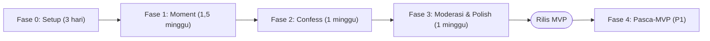

# Roadmap — Moment Pakde

Estimasi untuk 1 developer full-stack. Sesuaikan dengan kapasitas tim.

## Fase 0: Setup
- [ ] Init Next.js 15 + TypeScript + Tailwind + shadcn/ui
- [ ] ESLint, Prettier, Husky + lint-staged
- [ ] Project Supabase (dev & prod), Supabase CLI, migrasi awal
- [ ] Auth Google + trigger `profiles`
- [ ] Layout dasar, design tokens, font
- [ ] Deploy preview ke Vercel, env vars
- [ ] Sentry

**Selesai jika:** bisa login Google di URL preview dan profil terbuat.

## Fase 1: Moment
- [ ] Tabel `moments`, `moment_photos`, `tags`, `moment_tags` + RLS
- [ ] Bucket storage + kebijakan
- [ ] Halaman `/upload`: pilih foto, kompres, HEIC → WebP, hapus EXIF, blurhash
- [ ] `requestUploadUrls`, `createMoment`
- [ ] Feed moment + infinite scroll
- [ ] Detail moment `/m/[id]` + carousel
- [ ] Reaksi & komentar
- [ ] Profil `/u/[username]` + edit profil
- [ ] Halaman tag
- [ ] Edit & hapus moment
- [ ] Cron bersih-bersih foto yatim

**Selesai jika:** user bisa upload 5 foto dari iPhone & Android, tampil di feed < 3 detik.

## Fase 2: Confess
- [ ] Tabel `confessions`, `confession_reactions`, `blocked_senders`, `reports`, `app_settings` + view publik
- [ ] Turnstile + Upstash rate limit
- [ ] `lib/moderation`: filter PII (tolak), spam/link/selfharm (tahan), kata kasar/mention (flag) + unit test
- [ ] Form `/confess/new` + konfirmasi "langsung tampil" + banner sukses dengan kode rahasia
- [ ] Feed confess + filter kategori
- [ ] Detail confess `/c/[shortId]`
- [ ] Reaksi anonim
- [ ] Tombol laporkan + auto-hide ≥ 3 laporan (wajib ada sebelum confess dibuka, karena tidak ada peninjauan sebelum tampil)
- [ ] Saklar darurat `confess_paused`

**Selesai jika:** confess terkirim tanpa login dan langsung muncul di feed, confess berisi link tertahan, PII ditolak, 3 laporan menyembunyikan confess, dan tidak ada `user_id`/IP di database (diverifikasi manual).

## Fase 3: Moderasi & Polish
- [ ] Tabel `moderation_logs`
- [ ] `/admin`: tab Perlu Dicek / Ditahan / Terbaru, laporan, blokir, ban, pengaturan daftar kata & threshold
- [ ] Halaman `/aturan` dan `/privasi`
- [ ] Semua empty/loading/error state
- [ ] Open Graph image untuk moment & confess
- [ ] PWA manifest + ikon
- [ ] Audit Lighthouse (≥ 90 performa & aksesibilitas di mobile)
- [ ] Tes E2E Playwright untuk alur utama
- [ ] Uji RLS

**Selesai jika:** semua acceptance criteria P0 di [PRD.md](./PRD.md) tercentang.

## Rilis MVP
- [ ] Domain + SSL
- [ ] Seed konten awal (10–20 moment dari tim) agar feed tidak kosong
- [ ] Tunjuk 2–3 moderator dengan jadwal cek minimal 2x sehari
- [ ] Soft launch ke 1–2 batch/grup MagangHub selama 1 minggu, lalu sebar ke seluruh komunitas

## Fase 4: Pasca-MVP (P1)
- [ ] Kode rahasia: cek status & hapus confess sendiri
- [ ] Balasan anonim di confess
- [ ] Kartu confess untuk story IG
- [ ] Pencarian
- [ ] Notifikasi in-app
- [ ] Tandai user di moment, lokasi
- [ ] Urutan "Populer minggu ini"
- [ ] Mode gelap
- [ ] Login magic link

## Nanti (P2)
- Album/koleksi, "Hari ini di tahun lalu", web push, deteksi NSFW otomatis.
