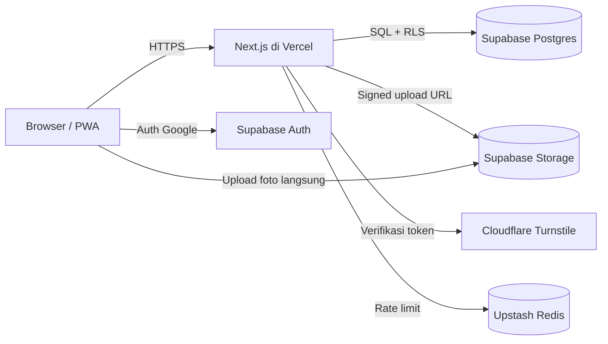
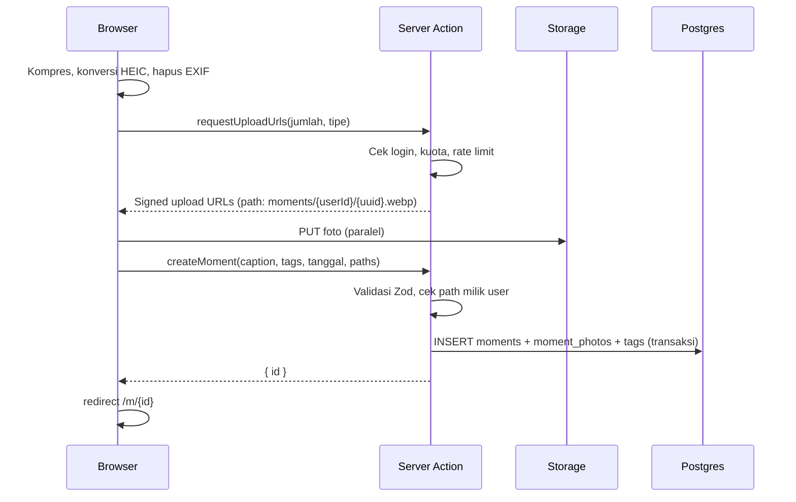
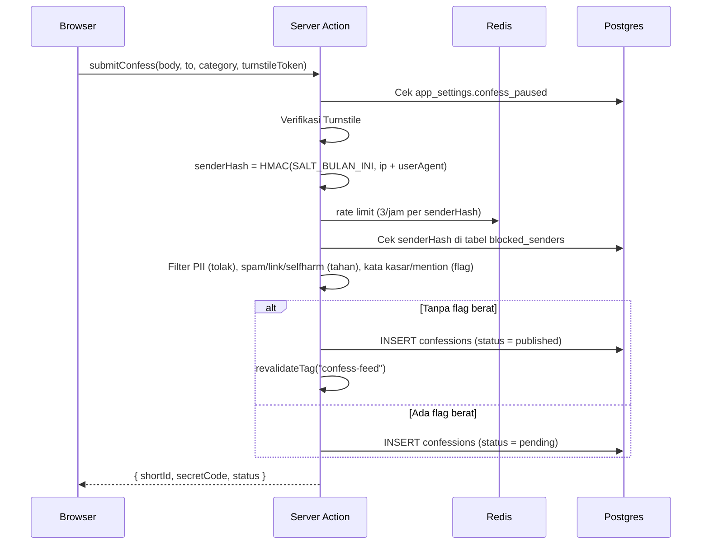

# Tech Spec — Moment Pakde

## 1. Stack

| Lapisan | Pilihan | Alasan |
|---|---|---|
| Framework | **Next.js 15** (App Router, TypeScript) | SSR untuk SEO halaman share, Server Actions, satu repo |
| Styling | **Tailwind CSS v4** + **shadcn/ui** | Cepat, konsisten, komponen aksesibel |
| Backend & DB | **Supabase** (Postgres, Auth, Storage, RLS) | Auth Google siap pakai, RLS untuk keamanan per baris, free tier cukup untuk MVP |
| Gambar | Supabase Storage + Next/Image (atau Cloudflare Images bila trafik besar) | Resize & format modern |
| Captcha | **Cloudflare Turnstile** | Gratis, tidak mengganggu |
| Rate limit | **Upstash Redis** (`@upstash/ratelimit`) | Serverless-friendly |
| Validasi | **Zod** | Satu skema untuk klien & server |
| Data fetching | Server Components + **TanStack Query** untuk infinite scroll & optimistic update |
| Kompresi foto | `browser-image-compression` + `heic2any` | Kurangi ukuran upload, dukung foto iPhone |
| Deploy | **Vercel** | Integrasi Next.js |
| Monitoring | Sentry + Vercel Analytics | Error & performa |
| Test | Vitest (unit), Playwright (E2E) | |

> Alternatif bila ingin tanpa Supabase: PostgreSQL (Neon) + Drizzle ORM + Auth.js + Cloudflare R2. Struktur dokumen ini tetap berlaku, hanya lapisan data yang berganti.

## 2. Arsitektur



## 3. Struktur Folder

```
moment-pakde/
├─ app/
│  ├─ (public)/
│  │  ├─ page.tsx                 # Beranda (tab Moment / Confess)
│  │  ├─ m/[id]/page.tsx          # Detail moment
│  │  ├─ c/[id]/page.tsx          # Detail confess
│  │  ├─ u/[username]/page.tsx    # Profil
│  │  ├─ tag/[slug]/page.tsx      # Halaman tag
│  │  ├─ confess/new/page.tsx     # Form confess (tanpa login)
│  │  └─ privasi/page.tsx
│  ├─ (auth)/
│  │  ├─ login/page.tsx
│  │  └─ auth/callback/route.ts
│  ├─ (member)/
│  │  ├─ upload/page.tsx
│  │  └─ settings/page.tsx
│  ├─ admin/
│  │  ├─ page.tsx                 # Ringkasan
│  │  ├─ confess/page.tsx         # Antrian confess
│  │  └─ reports/page.tsx         # Laporan
│  └─ api/
│     └─ og/[type]/[id]/route.tsx # Gambar Open Graph / kartu share
├─ components/
│  ├─ ui/                         # shadcn
│  ├─ moment/
│  ├─ confess/
│  └─ layout/
├─ lib/
│  ├─ supabase/{server,client,admin}.ts
│  ├─ actions/                    # Server Actions
│  ├─ validation/                 # Skema Zod
│  ├─ moderation/                 # Filter kata kasar & PII
│  ├─ ratelimit.ts
│  └─ fingerprint.ts              # Hash perangkat/IP
├─ supabase/
│  ├─ migrations/
│  └─ seed.sql
├─ tests/
└─ docs/
```

## 4. Alur Penting

### 4.1 Upload Moment



Foto yang ter-upload tapi tidak terhubung ke moment dalam 24 jam dihapus oleh cron (Supabase scheduled function).

### 4.2 Kirim Confess



**Aturan anonimitas (wajib):**
- Server Action confess **tidak boleh** membaca session user atau menyimpan `user_id`.
- IP mentah tidak disimpan dan tidak di-log. Matikan logging body request untuk route ini.
- `sender_hash` memakai salt yang dirotasi setiap bulan, sehingga hash lama tidak bisa dihubungkan ke perangkat setelah rotasi.
- `secret_code` disimpan sebagai hash (bcrypt/argon2), bukan teks asli.

### 4.3 Reaksi Confess Tanpa Login
- Klien membuat `device_id` acak (UUID) di `localStorage`.
- Server menyimpan `HMAC(SALT, device_id)` di `confession_reactions`, dengan unique constraint per confess.
- Ditambah rate limit per IP-hash untuk mencegah spam reaksi.

## 5. Keamanan

- **RLS aktif di semua tabel.** Klien hanya memakai anon key; operasi sensitif (confess, moderasi) lewat server dengan service role.
- Validasi MIME dari magic bytes, bukan ekstensi.
- Bucket `moments` publik-baca, tulis hanya lewat signed URL. Bucket `avatars` sama.
- Header keamanan: CSP ketat, `X-Frame-Options: DENY`, `Referrer-Policy: strict-origin-when-cross-origin`.
- Semua teks user dirender sebagai teks (tanpa `dangerouslySetInnerHTML`).
- Role admin disimpan di tabel `profiles.role`, dicek di middleware **dan** di setiap server action admin.

## 6. Environment Variables

```bash
NEXT_PUBLIC_SUPABASE_URL=
NEXT_PUBLIC_SUPABASE_ANON_KEY=
SUPABASE_SERVICE_ROLE_KEY=        # hanya server
NEXT_PUBLIC_TURNSTILE_SITE_KEY=
TURNSTILE_SECRET_KEY=
UPSTASH_REDIS_REST_URL=
UPSTASH_REDIS_REST_TOKEN=
CONFESS_HASH_SALT=                # dirotasi bulanan
SECRET_CODE_PEPPER=
NEXT_PUBLIC_SITE_URL=https://momentpakde.id
SENTRY_DSN=
```

## 7. Performa

- Feed memakai cursor pagination (`created_at`, `id`), 12 item per halaman.
- Gambar feed: `sizes="(max-width: 640px) 100vw, 600px"`, placeholder blur dari `blurhash` yang disimpan saat upload.
- Halaman detail di-cache ISR 60 detik; di-revalidate saat ada edit/hapus.
- Hitungan reaksi & komentar disimpan sebagai kolom denormalisasi yang diperbarui trigger.

## 8. Testing

| Jenis | Cakupan minimum |
|---|---|
| Unit | Filter PII, filter kata kasar, skema Zod, fungsi hash |
| Integrasi | Kebijakan RLS (user A tidak bisa edit moment user B; anon tidak bisa baca confess pending) |
| E2E | Login → upload moment → lihat di feed; kirim confess → langsung tampil di feed; confess berisi link → tertahan; 3 laporan → confess tersembunyi |
