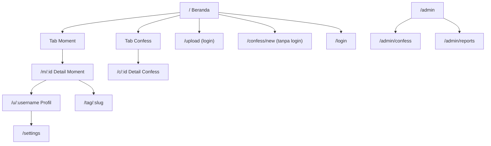

# UI/UX — Moment Pakde

## 1. Arah Visual

**Kesan:** hangat, akrab, sedikit iseng. Seperti mading/papan gabus di pantry kantor tempat anak magang menempel foto dan catatan, bukan media sosial korporat.

- **Moment** terasa seperti foto cetak/polaroid: tepi putih tipis, bayangan lembut, tanggal ditulis gaya tulisan tangan kecil.
- **Confess** terasa seperti sobekan kertas surat/sticky note dengan warna per kategori.
- Hindari: gradien ungu-biru generik, glassmorphism, ikon 3D, emoji berlebihan di UI.

### Design Tokens (awal)

| Token | Nilai | Pakai untuk |
|---|---|---|
| `--bg` | `#FAF6EF` (krem kertas) | Latar |
| `--surface` | `#FFFFFF` | Kartu |
| `--ink` | `#2B2420` (cokelat tua) | Teks utama |
| `--ink-muted` | `#6B5E55` | Teks sekunder (kontras ≥ 4.5:1 di `--bg`) |
| `--accent` | `#C2410C` (oranye bata) | Tombol utama, link |
| `--line` | `#E7DED2` | Border |
| Kategori confess | Naksir `#FCE7F3` · Terima Kasih `#DCFCE7` · Curhat `#E0E7FF` · Minta Maaf `#FEF3C7` · Unek-unek `#FEE2E2` · Lainnya `#F3F4F6` | Latar kartu confess |

| Tipografi | Font |
|---|---|
| Judul | **Fraunces** (serif hangat) |
| Isi & UI | **Plus Jakarta Sans** |
| Aksen tanggal | **Caveat** (hanya untuk tanggal moment, jangan untuk teks panjang) |

Radius: 12px kartu, 999px tombol pill. Spasi berbasis 4px.

Mode gelap: P1.

## 2. Peta Halaman



## 3. Navigasi

- **Mobile:** bottom bar 4 item: Beranda · Cari (P1) · **＋** · Profil. Tombol ＋ membuka sheet: "Upload Moment" / "Tulis Confess".
- **Desktop:** header dengan logo, tab Moment/Confess, tombol "Upload" dan "Confess", avatar.

## 4. Wireframe Teks

### 4.1 Beranda: Tab Moment
```
┌─────────────────────────────┐
│ Moment Pakde        [avatar]│
│ [ Moment ]  Confess         │
├─────────────────────────────┤
│ (o) @budi · Farewell Batch 3│
│ ┌─────────────────────────┐ │
│ │        FOTO 4:5         │ │
│ │                    1/3  │ │
│ └─────────────────────────┘ │
│ ❤️ 😂 🔥  24     💬 5       │
│ budi Hari terakhir magang,  │
│ makasih semuanya… lainnya   │
│ #farewell #batch3           │
│ ✎ 12 Okt 2026               │
├─────────────────────────────┤
│ …                           │
└─────────────────────────────┘
│  🏠    🔍    ＋    👤       │
```

### 4.2 Beranda: Tab Confess
```
┌─────────────────────────────┐
│ Moment   [ Confess ]        │
│ Semua · Naksir · Curhat · … │
├─────────────────────────────┤
│ ┌─ NAKSIR ────────────────┐ │
│ │ Untuk: intern IT yang   │ │
│ │ suka bawa tumbler hijau │ │
│ │                         │ │
│ │ "Tiap kamu lewat pantry │ │
│ │  kopiku jadi kemanisan."│ │
│ │                         │ │
│ │ 😍 12  🫶 4   2 jam lalu │ │
│ │                 [⋯]     │ │
│ └─────────────────────────┘ │
│ [ Tulis confess kamu ]      │
└─────────────────────────────┘
```

### 4.3 Upload Moment (`/upload`)
1. **Pilih foto:** grid pratinjau, drag untuk urutkan, ✕ untuk hapus. Maks. 5.
2. **Detail:** caption (textarea auto-grow + hitungan karakter), tag (chip input, saran: `#haripertama`, `#lembur`, `#makansiang`, `#farewell`), tanggal momen (date picker), lokasi (P1).
3. **Pengingat kecil** di atas tombol: "Pastikan tidak ada dokumen kantor atau layar kerja di foto."
4. **Kirim:** tombol "Bagikan Momen" + progress per foto.

Satu halaman scroll di mobile, bukan wizard multi-langkah.

### 4.4 Tulis Confess (`/confess/new`)
```
┌─────────────────────────────┐
│ ← Tulis Confess             │
│                             │
│ 🔒 Namamu tidak disimpan.   │
│    Apa yang disimpan? →     │
│                             │
│ Kategori                    │
│ (Naksir)(Terima Kasih)(…)   │
│                             │
│ Untuk (opsional)            │
│ [_______________________]   │
│                             │
│ Confess kamu                │
│ [                       ]   │
│ [                       ]   │
│                    0/1000   │
│                             │
│ ⓘ Confess langsung tampil   │
│   di feed begitu dikirim.   │
│ [Turnstile]                 │
│ [     Kirim Diam-diam     ] │
│                             │
│ Jangan sebut nama lengkap,  │
│ nomor HP, atau nama kantor  │
│ dengan nada menjelekkan.    │
└─────────────────────────────┘
```

Karena tidak ada peninjauan sebelum tampil, tombol kirim membuka **konfirmasi singkat** sekali per sesi: "Confess kamu akan langsung dilihat semua orang. Yakin?" [Kirim] [Cek lagi].

Setelah kirim (langsung tampil): user diarahkan ke `/c/:shortId` dengan banner di atas:
```
Confess kamu sudah tayang! 🤫

Kode rahasiamu: K7Q2-MX9P
Simpan kode ini kalau nanti mau menghapus confess.
[Salin kode]   [Bagikan]
```

Jika ditahan (ada link/spam):
```
Confess kamu perlu dicek dulu sebentar.
Biasanya nggak lama. Simpan kode ini untuk cek statusnya: K7Q2-MX9P
```

### 4.5 Admin: Confess
Tiga tab di atas: **Perlu Dicek** (badge jumlah) · **Ditahan** · **Terbaru**.

Tata letak dua kolom: kiri daftar (isi terpotong, kategori, umur, jumlah laporan, badge flag), kanan pratinjau penuh + tombol **Biarkan (K)** · **Sembunyikan (H)** · **Hapus (D)** · **Blokir pengirim**. Di tab Ditahan, tombol Biarkan diganti **Terbitkan (P)**. Setelah aksi, otomatis lompat ke item berikutnya.

Di header admin ada saklar darurat **Jeda Confess** untuk menghentikan sementara confess baru jika terjadi serangan spam atau drama.

## 5. State yang Wajib Didesain

| Komponen | Empty | Loading | Error |
|---|---|---|---|
| Feed Moment | "Belum ada momen. Jadi yang pertama!" + tombol Upload | Skeleton 3 kartu | "Gagal memuat. Coba lagi" |
| Feed Confess | "Belum ada confess. Ada yang mau kamu sampaikan?" | Skeleton | sama |
| Profil tanpa moment | "@budi belum upload momen" | | |
| Upload | | Progress per foto | Pesan per foto + tombol ulang |
| Confess PII | | | "Sepertinya ada nomor HP di confess kamu. Hapus dulu ya, demi keamanan semua orang." |
| Rate limit | | | "Pelan-pelan, Lur. Coba lagi dalam 20 menit." |
| Confess dijeda | "Confess lagi istirahat sebentar. Coba lagi nanti ya." | | |
| Konten disembunyikan | "Konten ini disembunyikan sementara karena dilaporkan" | | |
| Admin: Perlu Dicek kosong | "Aman terkendali. Nggak ada yang perlu dicek." | | |

## 6. Microcopy

| Tempat | Teks |
|---|---|
| Tagline beranda | Kumpulan momen & confess anak magang |
| Tombol upload | Bagikan Momen |
| Tombol confess | Kirim Diam-diam |
| Placeholder caption | Ceritain momen magangnya… |
| Placeholder confess | Tulis yang selama ini kamu pendam… |
| Konfirmasi hapus | Hapus momen ini? Foto dan komentarnya ikut hilang. |
| Laporkan | Ada yang nggak beres? |
| Login | Masuk dengan Google |
| Footer | Dibuat untuk seru-seruan komunitas MagangHub. |

Nada bahasa: santai, sapaan "kamu", gaya anak magang/mahasiswa. Boleh sedikit Jawa ("Lur", "monggo") tapi jangan berlebihan.

## 7. Aksesibilitas

- Target sentuh minimal 44×44px.
- Semua aksi bisa dengan keyboard; focus ring terlihat (`outline: 2px solid var(--accent)`).
- Carousel foto: tombol prev/next + swipe; indikator `1/3` dibacakan screen reader.
- Reaksi memakai `aria-pressed`.
- Warna kategori confess selalu disertai label teks, bukan warna saja.
- `prefers-reduced-motion`: matikan animasi masuk kartu.
